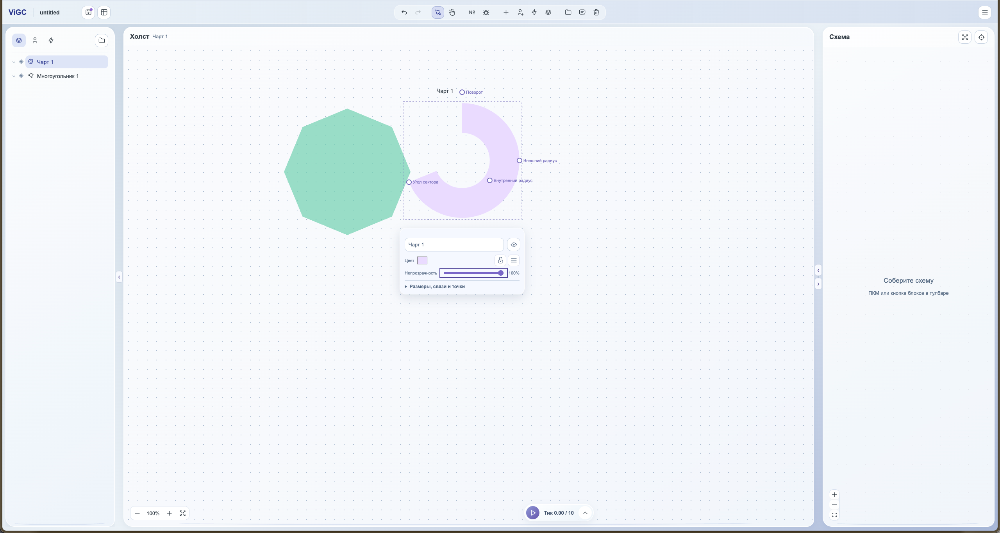
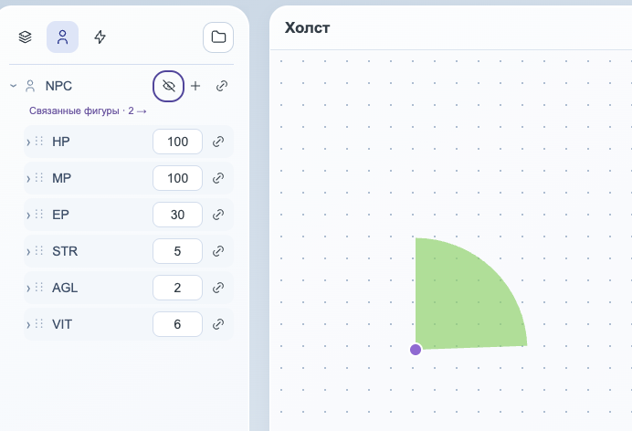
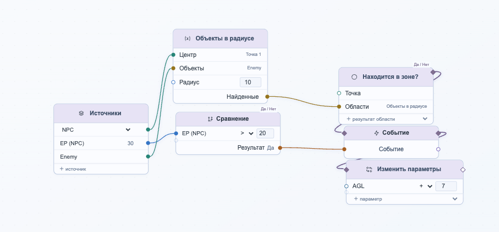
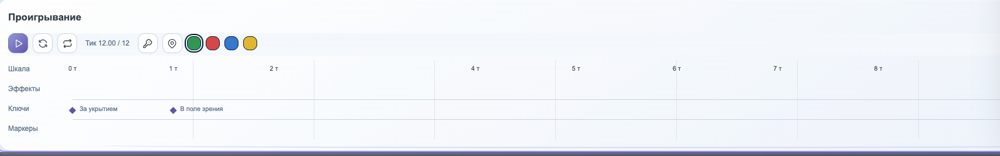
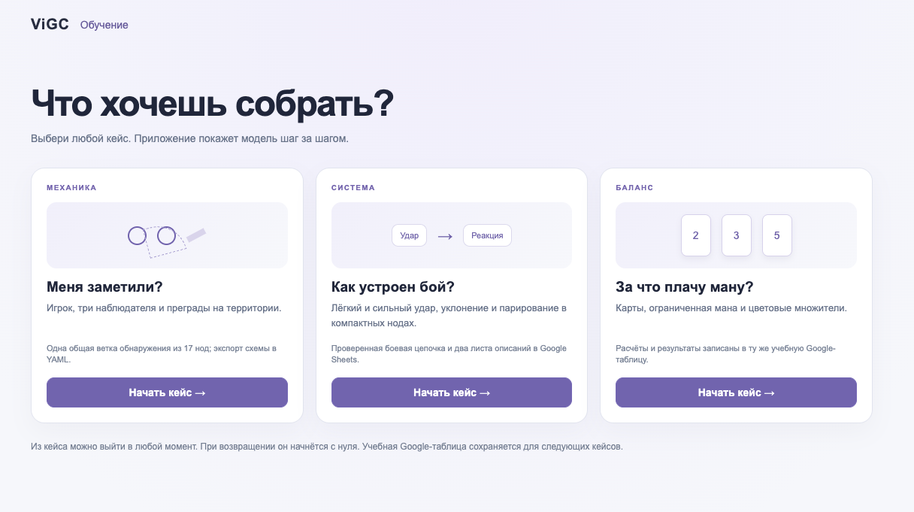

# ViGC

**Пространство для проектирования и проверки игровых механик: от первых правил до работающей модели, которую можно показать команде.**

Идею механики легко описать словами. Сложнее понять, что произойдёт, когда несколько её правил встретятся друг с другом: заметит ли страж персонажа за препятствием?  как быстро накопится тревога и что случится, когда она преодолеет допустимый порог?

В ViGC можно собрать такую ситуацию на сцене: связать объекты и их параметры с логикой, а затем запустить визуал и посмотреть на результат. Изменить что-то, повторить эксперимент, сохранить интересное состояние и передать собранную логику программистам на реализацию или упаковать в балансную гугл-таблицу и работать с ней дальше. И всё это в одной рабочей среде.

Проект прежде всего рассчитан на геймдизайнеров, в том числе балансных и системных, но также может пригодится любому, кто нуждается в визуализации своей идеи и симуляции механики, без сложной математики и кода. ViGC находится в стадии **Demo**: основа рабочего процесса уже собрана, но финальная проверка работаспособности и добор функционала перед Vertical Slice ещё впереди.

## Что здесь можно делать?

### Собрать игровую ситуацию на сцене
Разместите на холсте персонажей/зоны/препятствия/ многие другие объекты, с помощью редактируемых фигур. Создайте Сущности и параметры для них, свободно связывайте объекты сцены с  сущностями и их параметрами. Веселитесь.
Так, круговая область может быть зоной наблюдения, а параметром — внимательность стража.

Сцена помогает работать не только с числами, но и с пространственными отношениями: положением, расстоянием, попаданием в область, проверкой ближайших и/или конкретных объектов лучом. Можно записывать путь движения и смотреть, как изменения положения влияют на механику и её конкретные параметры.



### Описать правила и проверить их
В редакторе логики правила собираются из связанных блоков: данных, вычислений, условий, событий и действий. Параметры можно менять вручную или получать из вычислений; формулы дают компактный способ описать зависимости.

Допустим, персонаж попадает в область видимости противника, а препятствие не закрывает тому обзор. Тогда бдительность этого противника начинает расти. И в момент, когда она достигнет определённого значения, схема сможет вызвать событие поднимающее панику всего вражеского лагеря. Поменяйте положение, значение или условие и посмотрите, как это отразится на результате. Больше не нужно объяснять на салфетке, рисовать в миро одну статичную схему или ждать реализации в движке. Садись и играй, прямо в процессе.


### Проиграть механику на таймлайне
Таймлайн позволяет запустить модель, поставить её на паузу и перейти к нужному моменту. Во время проигрывания можно наблюдать движение и изменения параметров, а интересные моменты отмечать маркерами. Так же для таймлайна предусмотренна система ключей, позволяющая запустить зацикленную анимацию наглядно демонстрирующую изменение ключевых параметров и визуальное отображение механики, которое можно будет записать и отправить коллегам.

Так проще не только увидеть итог, но и разобраться, **как именно система к нему пришла**. в какой момент персонажа обнаружили и что было после этого.


### Передать логику дальше
Собранные блоки можно экспортировать в **YAML** (в дальнейшем ещё JSON и другие форматы) и передать программисту, или использовать в другом проекте ViGC. При импорте создаётся независимая копия логики. Внешние параметры и объекты потребуется привязать заново: YAML переносит схему, а не весь проект со сценой и внешними подключениями.

Это способ поделиться конкретным описанием правил для обсуждения и дальнейшей реализации. Экспорт сам по себе не превращает механику в готовый код игрового движка.

### Работать с Google Sheets
Параметры, результаты вычислений и сохранённые ключи можно явно привязать к ячейкам, листам и диапазонам Google Sheets. Поддерживаются направления обмена, включая двусторонний: изменения в приложении и таблице могут участвовать в синхронизации. Поддерживаемые скалярные формулы можно выгружать отдельно.

Для подключения нужна настроенная интеграция Google. Реальное подключение и полный двусторонний обмен в текущей конфигурации доступен только при соблюдении условий доверенности гугл; Подробности настройки — в разделе [Google Sheets](#google-sheets).

### Поручить сборку агенту
У ViGC есть локальный командный интерфейс: агент может создать JSON-проект, применять команды движка и проверять его состояние. Полученный файл можно открыть в приложении как отдельную копию и продолжить работу визуально. Это позволяет поручить агенту подготовку модели и затем самостоятельно изучить её на сцене и в редакторе логики.

CLI работает с файлом, а не с уже открытым проектом в реальном времени. Как и при любой агентской сборке, получившуюся механику стоит проверить на нужном сценарии.

## С чего начать?
На стартовом экране можно создать пустой проект, импортировать проектный JSON или открыть обучение. В обучении доступны три примера: обнаружение, бой и карточный баланс. Они показывают разные части рабочего процесса — от сцены и правил до симуляции и передачи результата.

Проекты сохраняются в браузере через меню проекта. После первого ручного сохранения включается автосохранение. Данные привязаны к браузеру и адресу приложения: очистка данных сайта удалит локальные проекты.


## Запуск локально

Требуются Node.js **26.12.0** и npm **12.2.0**.

```sh
npm ci
npm run dev
```

Откройте [http://127.0.0.1:5182](http://127.0.0.1:5182). Для сборки используйте `npm run build`, для локального просмотра сборки — `npm run preview`. Оба режима используют тот же адрес и порт; одновременно запустить их на нём не получится.

Если файловая среда не сообщает об изменениях, включите опрос файлов: `VIGC_POLLING=1 npm run dev`.

### Google Sheets

Для интеграции разработчику нужно настроить `VITE_GOOGLE_CLIENT_ID`, `VITE_GOOGLE_API_KEY` и `VITE_GOOGLE_APP_ID` из одного проекта Google Cloud; шаблон находится в [.env.example](.env.example). Для локальной разработки в OAuth-клиенте должен быть разрешён origin `http://127.0.0.1:5182`. Публичное использование также зависит от настроек и применимой проверки Google. Без интеграции локальная работа и сохранение доступны отдельно.

Первый обмен запускается вручную. После этого изменения приложения объединяются с небольшой задержкой, а внешние изменения проверяются в видимой вкладке. Формулы выгружаются в отдельном режиме; неподдерживаемые операции сопровождаются пояснением.

Такие ограничения связаны с отсутствием стабильного домена на версии Demo. При переходе на версию Beta домен появится и таких сложных действий от пользователя не потребуется.

### Командный интерфейс

```sh
npm run agent -- help
npm run agent -- init ./scene.json "Моя механика"
npm run agent -- apply ./scene.json commands.json
npm run agent -- inspect ./scene.json
```

Файл команд содержит одну команду движка или массив команд. Каждая принятая команда сохраняется сразу; при отклонении остаётся последний принятый результат. `behavior.check` и `behavior.fire` выводят временные результаты выполнения, но не сохраняют их как авторское состояние проекта.

## Проверки и состояние проекта

```sh
npm run test:base
npm run test:spatial
npm run build
```

Это базовые примеры проверок; для отдельных областей в `package.json` есть дополнительные наборы. История версий находится в [CHANGELOG.md](Documents/User/CHANGELOG.md).

### Приятного проектирования!
